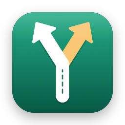
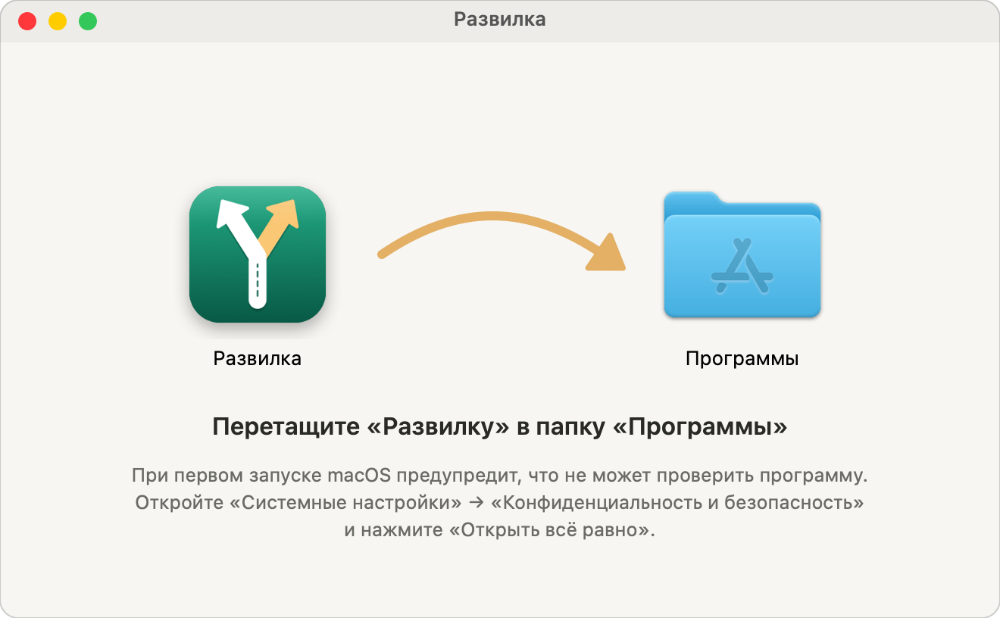
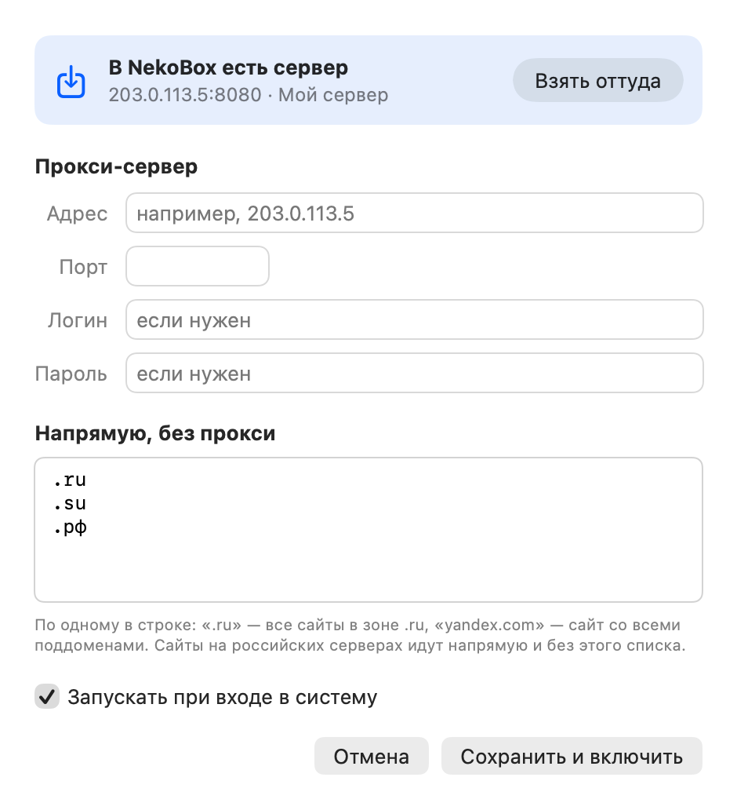
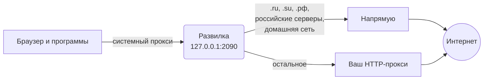

<p align="center">
  
</p>

<h1 align="center">Развилка</h1>

<p align="center">
  Прокси-клиент для macOS в строке меню.<br>
  Российские сайты открываются напрямую, всё остальное идёт через ваш прокси-сервер.
</p>

<p align="center">
  <a href="https://github.com/cbrekrut/razvilka/releases/latest"><b>Скачать для macOS</b></a>
  &nbsp;·&nbsp; macOS 14 и новее &nbsp;·&nbsp; Apple Silicon и Intel &nbsp;·&nbsp; бесплатно, MIT
</p>

---

## Что это

Развилка включает на Mac системный прокси и сама решает, куда отправить каждое соединение:

- **напрямую**: сайты в зонах `.ru`, `.su`, `.рф` и все сайты на российских серверах, как будто прокси нет;
- **через ваш сервер**: всё остальное;
- **всегда напрямую**: домашняя сеть (роутер, принтер, сетевой диск).

Для работы нужен свой HTTP-прокси, например купленный у продавца прокси, с логином и паролем или без них.

## Возможности

- Значок-развилка в строке меню: включение одним щелчком и текущая скорость.
- Два режима: «Российские сайты напрямую» и «Всё через прокси».
- «Проверить связь и скорость»: страна выхода в интернет, задержка, скорость скачивания.
- Перенос сервера и списка сайтов из NekoBox (nekoray) одной кнопкой.
- Предупреждение, если сервер не принял пароль или не отвечает.
- Запуск при входе в систему. Если программа упадёт, macOS перезапустит её, а прокси в настройках не останется указывать в пустоту.
- Без драйверов, без служб с правами администратора и без сбора данных: программа меняет только настройки прокси macOS.

## Установка

1. Скачайте `Razvilka-1.0.0.dmg` со страницы [Releases](https://github.com/cbrekrut/razvilka/releases/latest).
2. Откройте его и перетащите «Развилку» в «Программы».

   

3. Запустите «Развилку» из «Программ». macOS скажет, что не может проверить программу: она не подписана платным сертификатом Apple. Нажмите «Готово», затем откройте **Системные настройки → Конфиденциальность и безопасность**, внизу у строки про «Развилку» нажмите **«Открыть всё равно»** и подтвердите паролем. Это нужно сделать один раз.
4. В окне настроек укажите адрес, порт, логин и пароль сервера. Если раньше стоял NekoBox, просто нажмите «Взять оттуда». Затем нажмите «Сохранить и включить».

   

Проверить, что файл не подменён: сравните `shasum -a 256 Razvilka-1.0.0.dmg` с файлом `.sha256` в том же релизе.

## Как это работает



- Развилка слушает только `127.0.0.1:2090` (HTTP и SOCKS5), из сети она не видна.
- Если по имени сайта непонятно, российский он или нет, Развилка узнаёт адрес сервера сайта через DNS Google (запасной вариант — Cloudflare). Запрос идёт по HTTPS через ваш сервер, поэтому ответ нельзя подменить по дороге. Затем адрес сверяется со списком российских сетей. Пока идёт проверка, соединение через сервер уже открывается, так что зарубежные сайты из-за проверки не тормозят. Ответы запоминаются на время жизни записи DNS.
- Список российских сетей ([`Resources/ru-cidr.txt`](Resources/ru-cidr.txt)) собран из открытой статистики [RIPE NCC](https://www.ripe.net/) по стране регистрации адресов.

## Ограничения

- Поддерживается только HTTP-прокси (метод CONNECT). SOCKS5, Shadowsocks, VLESS и другие протоколы на стороне сервера не поддерживаются.
- Соединение с HTTP-прокси не шифруется: логин и пароль передаются в открытом виде. Содержимое HTTPS-сайтов при этом защищено. Это свойство самого HTTP-прокси, а не Развилки.
- Работают программы, которые следуют системным настройкам прокси: браузеры и большинство приложений. Программы со своими сетевыми настройками идут мимо.
- Интерфейс только на русском.

## Где что лежит

| Что | Где |
|---|---|
| Программа | `/Applications/Развилка.app` |
| Настройки (доступны только вашей учётной записи, там пароль) | `~/Library/Application Support/Razvilka/config.json` |
| Журнал: включения и ошибки сервера, без адресов сайтов | `~/Library/Application Support/Razvilka/proxy.log` |
| Автозапуск | `~/Library/LaunchAgents/io.github.cbrekrut.razvilka.plist` |

## Удаление

Выберите «Выйти» в меню Развилки: настройки прокси вернутся как были. Затем удалите программу и её файлы:

```bash
rm -rf "/Applications/Развилка.app" ~/Library/Application\ Support/Razvilka ~/Library/LaunchAgents/io.github.cbrekrut.razvilka.plist
```

## Сборка из исходников

Нужны Command Line Tools (`xcode-select --install`) и Python 3. Xcode не нужен.

```bash
git clone https://github.com/cbrekrut/razvilka.git
cd razvilka
./build.sh               # собрать, проверить и установить в /Applications
./build.sh --no-install  # только собрать и проверить
./build.sh --dmg         # собрать установщик dist/Razvilka-<версия>.dmg (нужен: pip install dmgbuild)
```

Что проверяется при каждой сборке:

- встроенные проверки (`Razvilka --selftest`): правила, разбор протоколов, настройки;
- 21 сценарий на поддельных сайтах, сервере и DNS ([`tests/test_proxy.py`](tests/test_proxy.py)): какой путь выбирается, неверный пароль, недоступный сервер, большие файлы, параллельные запросы, отсутствие зависших соединений;
- снимки окна настроек и значка в `build/snapshots`.

Чтобы обновить список российских сетей, используйте [`tools/ru_cidr_from_ripe.py`](tools/ru_cidr_from_ripe.py).

## English

Razvilka (Russian for “fork in the road”) is a macOS menu-bar client for an HTTP proxy with split routing: Russian sites (`.ru`, `.su`, `.рф` and servers registered in Russia) go direct, everything else goes through your proxy. Native Swift, no dependencies, macOS 14+, universal binary. The UI is in Russian. MIT licensed.

## Лицензия

[MIT](LICENSE). Список сетей основан на открытой статистике RIPE NCC.
